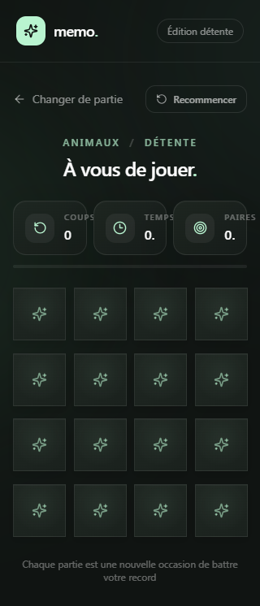

## License
   © 2026 Elhabchi Mohammed. All Rights Reserved.

# Memo — jeu de mémoire

Jeu de mémoire React avec trois niveaux, quatre thèmes, chronomètre, animations de retournement et records sauvegardés par niveau dans le navigateur.

## Démo



## Lancer le projet

```bash
npm install
npm run dev
```

Pour générer puis prévisualiser la version de production :

```bash
npm run build
npm run preview
```

## Organisation

- `src/App.jsx` assemble les vues et conserve les meilleurs scores.
- `src/hooks/useMemoryGame.js` gère les cartes, les coups, les correspondances et le chronomètre.
- `src/data/gameOptions.js` définit les niveaux, les thèmes et le mélange Fisher–Yates.
- `src/components/` contient l’écran de configuration, le plateau, les cartes, l’en-tête et la modal de victoire.
- `src/index.css` rassemble Tailwind, les styles de cartes et les animations.

Les records sont stockés dans `localStorage` sous la clé `memo-best-scores`.
